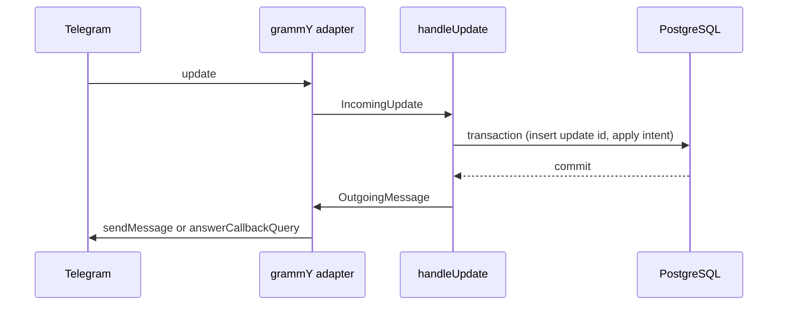

# FinBot MVP Design

**Spec**: `.specs/features/finbot-mvp/spec.md`
**Status**: Draft

---

## Architecture Overview

One NestJS 12 process. grammY long polling is the only ingress. There is no HTTP controller, no Swagger document, and no BullMQ queue in this feature. The constitution already reserves those for a later spec that needs them.

Three layers, and only three:

1. **Domain.** Pure TypeScript. Money, calendar dates, category suggestion, the phrase parser, draft transitions, and balance math.
2. **Application.** One use case per command family, plus `handleUpdate` as the front door. It owns idempotency, owner checks, reply text, and the rule that the database commits before any Telegram send.
3. **Infrastructure.** TypeORM 1.1 against PostgreSQL, a grammY adapter, the São Paulo clock, and Nest wiring.

Two shapes were set aside. An HTTP webhook plus controllers needs a public URL this spec does not require. A stored balance column updated on confirm contradicts TX-23, which computes balance from confirmed rows.



If the send throws, the adapter logs `reply_failed` with the update id and the intent name, then swallows the error. The committed row stays (TX-24). The log line does not include the reply body, because that body contains the amount.

---

## Code Reuse Analysis

### Existing Components to Leverage

`src/` and `specs/` are empty. There is no application code to extend. The patterns below are the ones this feature introduces, and later features should follow them.

| Component | Location | How to Use |
| --- | --- | --- |
| Constitution layering rule | `.specs/constitution.md` | Domain and application stay free of Nest, TypeORM, grammY, Redis, and HTTP clients |
| Requirement IDs | `.specs/features/finbot-mvp/spec.md` | Each acceptance criterion maps to a test and a task |
| Discussed behavior | `.specs/features/finbot-mvp/context.md` | Draft lifetime, edit phrases, rename, category ties, and `em DD/MM` are already decided |

### Integration Points

| System | Integration Method |
| --- | --- |
| Telegram Bot API | grammY `bot.start()` long polling. Token from `BOT_TOKEN`. Never logged. |
| PostgreSQL | TypeORM `DataSource.initialize()`. URL from `DATABASE_URL`. `synchronize: false`. Schema from SQL in `src/infrastructure/persistence/schema.sql`. |
| Clock | `Intl.DateTimeFormat` with `timeZone: 'America/Sao_Paulo'`. No date library. |
| Tests | Jest. Unit tests use in-memory ports. Integration tests start PostgreSQL with `@testcontainers/postgresql` (`PostgreSqlContainer`, image `postgres:18-alpine`, `getConnectionUri()`). |

Node engine is `>=22.22.3`. NestJS 12 application code runs on older 22.x releases, but `@nestjs/schematics` 12 refuses to generate a project below `22.22.3`. Pinning the higher floor keeps `nest new` and `npm run build` on the same runtime.

Package floor: `@nestjs/core` 12.4.x, `@nestjs/typeorm` 12.0.x, `typeorm` 1.1.x, `grammy` 1.x, `pg`. Do not install the `typeorm@legacy` 0.3 tag.

---

## Components

### Money

- **Purpose**: Parse the accepted `R$` forms into centavos and format centavos as pt-BR.
- **Location**: `src/domain/money.ts`
- **Interfaces**:
  - `parseAmount(lexeme: string): number | 'invalid'` — `lexeme` is the `R$ ...` token only, not a full sentence.
  - `formatCentavos(centavos: number): string` — full token, `R$ 3.500,00` or `-R$ 42,00`.
  - `formatDigits(centavos: number): string` — absolute digits only, `3.500,00`, for sentences that already contain `R$` or `-R$`.
- **Dependencies**: none
- **Reuses**: none

Accepted lexemes, after exactly one space following `R$`: a plain integer (`42`, `3500`) or grouped thousands (`1.234`, `3.500`, `1.000.000`), optional fractional part of exactly two digits (`,00`). Dots, when present, separate groups of three from the right. `R$42` (no space), `R$ 42.50`, `R$ 42,5`, `R$ 0`, `R$ 0,00`, and values above `100000000` centavos return `'invalid'`.

### Calendar date

- **Purpose**: Resolve `hoje`, `ontem`, and `em D/M` or `em DD/MM` in America/Sao_Paulo.
- **Location**: `src/domain/calendar-date.ts`
- **Interfaces**:
  - `interface CalendarDate { year: number; month: number; day: number }`
  - `todayInSaoPaulo(now: Date): CalendarDate`
  - `addDays(date: CalendarDate, days: number): CalendarDate`
  - `resolveDate(clause: 'omitted' | 'hoje' | 'ontem' | { day: number; month: number }, now: Date): CalendarDate | 'invalid'`
  - `formatDate(date: CalendarDate): string` — `DD/MM/AAAA`, zero-padded.
  - `isInMonth(date: CalendarDate, month: CalendarDate): boolean` — same year and month. `month.day` is ignored.
- **Dependencies**: none
- **Reuses**: none

`em 31/02`, a day that does not exist in the current São Paulo year (including 29/02 outside a leap year), and any date after today in that year return `'invalid'`. Today is valid. The year is always the current São Paulo year, never the previous year when the day is already past.

### Category suggestion

- **Purpose**: Pick at most one owned category for a draft description.
- **Location**: `src/domain/suggest-category.ts`
- **Interfaces**:
  - `suggestCategory(description: string, ownedNames: string[]): string | null`
- **Dependencies**: none
- **Reuses**: none

Rules, in order:

1. If `description` equals `Uber` ignoring case and `ownedNames` contains `Transporte` ignoring case, return the stored `Transporte` spelling. Stop. Do not also count other matches.
2. Otherwise collect owned names that appear as a whole word in `description`, case-insensitive. A whole word is bounded by the start or end of the string or by a character that is not a Unicode letter.
3. One match returns that stored name. Zero or two or more returns `null` (`sem categoria`).

The caller passes the description field only, never the date clause or `na conta`.

### Balance

- **Purpose**: Sum confirmed income centavos minus confirmed expense centavos. Nothing in the schema stores a running balance.
- **Location**: `src/domain/balance.ts`
- **Interfaces**:
  - `accountBalance(rows: LedgerRow[], accountId: string): number`
  - `totalBalance(rows: LedgerRow[]): number`
- **Dependencies**: none
- **Reuses**: none

`LedgerRow` is `{ accountId: string; kind: 'expense' | 'income'; amountCentavos: number }`. Pending and cancelled drafts are not rows.

### Draft transitions

- **Purpose**: Allow pending to confirmed and pending to cancelled, and refuse every other move.
- **Location**: `src/domain/draft.ts`
- **Interfaces**:
  - `type DraftStatus = 'pending' | 'confirmed' | 'cancelled'`
  - `confirm(status: DraftStatus): 'confirmed' | 'already_confirmed' | 'cancelled'`
  - `cancel(status: DraftStatus): 'cancelled' | 'already_confirmed' | 'cancelled_again'`
- **Dependencies**: none
- **Reuses**: none

`Editar` does not call these functions. The draft stays `pending`.

### Account default

- **Purpose**: Keep exactly one default whenever the user has at least one account.
- **Location**: `src/domain/account.ts`
- **Interfaces**:
  - `markCreated(existing: AccountSnapshot[], created: AccountSnapshot): AccountSnapshot[]` — first account is the only default; a later account is not default.
  - `markDefault(existing: AccountSnapshot[], accountId: string): AccountSnapshot[]`
  - `removeAccount(existing: AccountSnapshot[], accountId: string): { accounts: AccountSnapshot[]; error: null | 'only_account' | 'has_transactions' }` — if the removed account was default, the remaining account with the earliest `createdAt` becomes the only default. Tie on `createdAt`: smaller `id` string wins.
- **Dependencies**: none
- **Reuses**: none

`has_transactions` is an input flag on the snapshot (`hasConfirmedTransactions: boolean`), not a query. The repository tells the domain; the domain does not talk to the database.

Name length is checked here too: `validateName(raw: string): string | 'invalid'` trims and accepts 1 to 40 characters. Description length, 1 to 80, lives in `src/domain/draft.ts` as `validateDescription`.

### Parser

- **Purpose**: Turn one message into a command, or `unparsed`. It does not read the database and it does not decide whether a draft is pending.
- **Location**: `src/domain/parser.ts`
- **Interfaces**:
  - `parseMessage(text: string): ParsedCommand`
- **Dependencies**: `parseAmount` from `src/domain/money.ts`. Date clauses are returned unvalidated; `resolveDate` runs in the application so the clock stays injectable.
- **Reuses**: `src/domain/money.ts`

Keyword match is case-insensitive. Captured names keep the casing the user typed, then the application trims them. Accent is significant: `Histórico` matches, `historico` does not. `descrição` matches, `descricao` does not.

Try, in this order, and stop at the first match:

1. `Listar contas`, `Listar categorias`, `Saldo`, `Histórico`.
2. `Criar conta <nome>`, `Renomear conta <nome> para <novo>` (split on the first ` para `), `Definir conta padrão <nome>`, `Excluir conta <nome>`, `Criar categoria <nome>`.
3. Questions, optional trailing `?` and surrounding space: `Quanto gastei este mês`, `Qual é o saldo total das minhas contas`, `Qual foi minha maior despesa`, `Quanto gastei com <texto>`.
4. Edit phrases: `valor R$ <amount>`, `categoria <nome>`, `descrição <texto>`, `conta <nome>`.
5. `Gastei` / `Recebi` sentences below.
6. `unparsed`.

Expense shape: `Gastei`, then an amount lexeme, then `no` or `na` or `em`, then a description. The description stops before a trailing `hoje`, `ontem`, or `em D/M` / `em DD/MM`, and before a trailing `na conta <nome>`. Both suffixes are optional. `em` as the description preposition and `em` as the date preposition are different tokens: the date form is only recognized at the end of the remainder.

Income shape: `Recebi`, amount lexeme, `de`, description, same optional suffixes.

`Confirmar`, `Cancelar`, and `Editar` as text are not phrases. They fall through to `unparsed`. Buttons arrive as callbacks, not as parser input.

`ParsedCommand` is a discriminated union with `type` of: `list_accounts`, `list_categories`, `balance`, `history`, `create_account`, `rename_account`, `set_default_account`, `delete_account`, `create_category`, `spent_this_month`, `total_balance`, `largest_expense`, `spent_in_category`, `edit_amount`, `edit_category`, `edit_description`, `edit_account`, `expense`, `income`, `unparsed`.

### Ports and in-memory ledger

- **Purpose**: The application depends on interfaces. Unit tests implement them in memory. TypeORM implements the same interfaces later.
- **Location**: `src/application/ports.ts`, `src/application/in-memory-ledger.ts`
- **Interfaces**:
  - `UnitOfWork.run<T>(fn: (repos: Repositories) => Promise<T>): Promise<T>` — one transaction. The in-memory version runs `fn` and commits the mutated maps only if `fn` resolves.
  - Repositories filter every read and write by `userId`. A method that cannot see another user's row returns not-found, not the row.
  - `ProcessedUpdates.tryBegin(updateId: number): Promise<boolean>` — `false` when that update id is already stored. The insert happens inside the same `run`.
  - `Clock.now(): Date`
  - `Ids.next(): string` — `crypto.randomUUID()` in production.
  - `AuditLog.record(event: { updateId: number; intent: string }): void`
  - `Notifier.send(chatId: number, message: OutgoingMessage): Promise<void>` — called by `handleUpdate` after `run` resolves, never inside it.
- **Dependencies**: domain types
- **Reuses**: none

`OutgoingMessage` is `{ text: string; buttons?: boolean }`. `buttons: true` means the three labels Confirmar, Editar, Cancelar, in that order. The application does not build Telegram markup.

### Resolve user

- **Purpose**: Create the FinBot user on first sight and seed Transporte and Alimentação once.
- **Location**: `src/application/resolve-user.ts`
- **Interfaces**:
  - `resolveUser(repos, telegramUserId: number): Promise<User>`
- **Dependencies**: ports
- **Reuses**: in-memory ledger in tests
- **Requirement**: USER-01, USER-02, USER-06 (the caller skips this when the id is missing), CAT-01

### Account commands

- **Purpose**: Create, list, rename, set default, and delete accounts, including every refusal reply in the accounts story.
- **Location**: `src/application/account-commands.ts`
- **Interfaces**:
  - `executeAccount(repos, userId: string, command: ParsedCommand): Promise<OutgoingMessage>`
- **Dependencies**: `src/domain/account.ts`, ports
- **Reuses**: domain account rules
- **Requirement**: ACCT-01 through ACCT-15

List order is `createdAt` ascending, then `id` ascending. The reply is `Contas:` plus one line per account. The default line is `- <nome> (padrão): <formatCentavos>`. Any other line is `- <nome>: <formatCentavos>`. Balance comes from `accountBalance` over confirmed transactions, not from a column.

### Category commands

- **Purpose**: Create and list categories. Seed stays in `resolveUser`.
- **Location**: `src/application/category-commands.ts`
- **Interfaces**:
  - `executeCategory(repos, userId: string, command: ParsedCommand): Promise<OutgoingMessage>`
- **Dependencies**: ports, `validateName` reused with the category error text
- **Reuses**: `src/domain/account.ts` `validateName` for the 1–40 rule
- **Requirement**: CAT-02 through CAT-05

List order matches accounts: `createdAt` ascending, then `id`. Seeded rows are inserted with Transporte first, so they list first.

### Open draft

- **Purpose**: Validate an expense or income sentence and replace any pending draft with one new pending draft.
- **Location**: `src/application/open-draft.ts`
- **Interfaces**:
  - `openDraft(repos, userId: string, command: ParsedCommand): Promise<OutgoingMessage>`
- **Dependencies**: money, calendar date, suggest-category, parser command, ports
- **Reuses**: those domain functions
- **Requirement**: TX-01, TX-02, TX-13, TX-15, TX-16, TX-17, TX-18, TX-19, TX-20, TX-21, TX-22, TX-25

No account at all: do not insert a draft. Unknown `na conta` name: do not insert a draft. Invalid amount, date, or description: do not insert a draft. A new valid sentence cancels the previous pending draft in the same transaction and inserts one pending draft.

The reply is the draft card. Expense header `Identifiquei uma despesa:`. Income header `Identifiquei uma receita:`. Lines, in order: `- Valor: <formatCentavos>`, `- Categoria: <stored name or sem categoria>`, `- Descrição: <description>`, `- Conta: <account name>`. `buttons: true`.

### Edit draft

- **Purpose**: Apply `valor`, `categoria`, `descrição`, and `conta` while a draft is pending, and answer the Editar button with instructions.
- **Location**: `src/application/edit-draft.ts`
- **Interfaces**:
  - `editDraft(repos, userId: string, command: ParsedCommand): Promise<OutgoingMessage>`
  - `editHelp(): OutgoingMessage` — fixed instruction text, draft unchanged
- **Dependencies**: money, ports
- **Reuses**: `parseAmount`, draft card from `open-draft.ts` (export `renderDraft`)
- **Requirement**: TX-07, TX-08, TX-09, TX-10, TX-11, TX-12

Unknown category or account keeps the previous value and does not show the card. The instruction text is `Para editar, envie: valor R$ <valor>, categoria <nome>, descrição <texto> ou conta <nome>.` with `buttons` omitted.

### Confirm and cancel

- **Purpose**: Move a pending draft to confirmed (one ledger row) or cancelled (no ledger row), and refuse repeats.
- **Location**: `src/application/confirm-draft.ts`
- **Interfaces**:
  - `confirmDraft(repos, userId: string, draftId: string): Promise<OutgoingMessage>`
  - `cancelDraft(repos, userId: string, draftId: string): Promise<OutgoingMessage>`
- **Dependencies**: `src/domain/draft.ts`, ports
- **Reuses**: draft transitions
- **Requirement**: TX-03, TX-04, TX-05, TX-06, TX-23, TX-24

The ledger insert copies type, amount, category, description, account, and `occurredOn` from the draft and sets `confirmedAt` from `Clock.now()`. `draftId` is unique on the ledger table. A missing draft, or a draft owned by someone else, gets the same reply as a cancelled draft and writes nothing: `Esse lançamento foi cancelado.`

TX-24 is not a branch inside this function. `handleUpdate` sends the reply only after `UnitOfWork.run` resolves. The test gives `run` a notifier that throws and asserts the ledger row is still visible.

### Queries

- **Purpose**: `Saldo`, `Histórico`, and the four questions. Income is ignored by the three spending questions.
- **Location**: `src/application/queries.ts`
- **Interfaces**:
  - `executeQuery(repos, userId: string, command: ParsedCommand, now: Date): Promise<OutgoingMessage>`
- **Dependencies**: balance, calendar date, money
- **Reuses**: domain formatters
- **Requirement**: QRY-01 through QRY-14

`Saldo` with no account: `Você ainda não tem contas. Exemplo: "Criar conta Nubank".`

`Saldo` with accounts uses the same lines as `Listar contas`, then `Total: <formatCentavos of the sum>`.

`Histórico` takes the 10 confirmed transactions with the latest `confirmedAt`, then the larger `id` as a tie-break. Each line is `DD/MM/AAAA — Despesa|Receita — <descrição> — <categoria ou sem categoria> — <conta> — <formatCentavos>`. The separator is U+2014. Empty: `Você ainda não tem lançamentos.`

`Quanto gastei este mês?` sums confirmed expenses whose `occurredOn` falls in the current São Paulo month. Reply `Você gastou R$ <formatDigits> este mês.` Zero is `Você gastou R$ 0,00 este mês.`

`Qual é o saldo total das minhas contas?` with a negative sum: `Seu saldo total é -R$ <formatDigits>.` Otherwise, including no accounts: `Seu saldo total é R$ <formatDigits>.`

`Qual foi minha maior despesa?` picks the greatest expense amount, then the latest `confirmedAt`. Reply `Sua maior despesa foi R$ <formatDigits> em <descrição> (<categoria ou sem categoria>) no dia DD/MM/AAAA.` None: `Você ainda não tem despesas.`

`Quanto gastei com <texto>?` matches the trimmed text to an owned category, ignoring case. Reply uses the stored name: `Você gastou R$ <formatDigits> com <stored> este mês.` No match: `Não encontrei a categoria "<texto>".` and the sum is not reported as zero.

### handleUpdate

- **Purpose**: The only application entry. Idempotency, logging, routing, and send-after-commit.
- **Location**: `src/application/handle-update.ts`
- **Interfaces**:
  - `handleUpdate(uow: UnitOfWork, notifier: Notifier, input: IncomingUpdate): Promise<void>`
  - `IncomingUpdate` is `{ updateId: number; telegramUserId: number | null; chatId: number | null; text?: string; callback?: { action: 'confirm' | 'edit' | 'cancel'; draftId: string } }`
- **Dependencies**: every application command module, parser, ports
- **Reuses**: those modules
- **Requirement**: USER-03, USER-04, USER-05, USER-06, TX-14, TX-26, QRY-15

Order inside the transaction:

1. `tryBegin(updateId)`. If `false`, return without a second write and without a second send.
2. If `telegramUserId` is null, log intent `ignored_missing_user` and send nothing.
3. `resolveUser`.
4. If `callback` is set, run confirm, cancel, or edit-help for that draft id.
5. Else `parseMessage`. If the command is an edit phrase and no draft is pending, treat it as `unparsed`.
6. If the command is expense or income, `openDraft` (this is the only path that cancels a pending draft).
7. Otherwise run the account, category, or query command and leave the pending draft as it is.
8. Log `{ updateId, intent }` once. Intent is the command `type`, or `ignored_missing_user`.

After commit, if there is a message and a `chatId`, call `notifier.send`. On rejection, log `{ updateId, intent: '<intent>' }` is already done; add one more record `{ updateId, intent: 'reply_failed' }` and do not throw. Do not log `text`, the amount, or the outgoing text.

Unparsed reply: `Não entendi. Exemplos: "Gastei R$ 42 no Uber hoje" ou "Quanto gastei este mês?"`

### Schema and repository

- **Purpose**: PostgreSQL tables and the TypeORM adapter of `Repositories`.
- **Location**: `src/infrastructure/persistence/schema.sql`, `src/infrastructure/persistence/ledger.repository.ts`
- **Interfaces**: implements `UnitOfWork` and `Repositories`
- **Dependencies**: `pg`, `typeorm` `DataSource`
- **Reuses**: port types
- **Requirement**: USER-04 at the SQL boundary, TX-23 (no balance column), TX-04 (unique `draft_id`)

`schema.sql` is the source of truth. Entities map those columns. `synchronize` stays false. The repository runs `schema.sql` at the start of the integration suite.

Tables:

| Table | Columns | Constraints |
| --- | --- | --- |
| `users` | `id uuid`, `telegram_user_id bigint`, `created_at timestamptz` | unique `telegram_user_id` |
| `accounts` | `id`, `user_id`, `name varchar(40)`, `is_default boolean`, `created_at` | unique `(user_id, lower(name))`; partial unique one `is_default` per `user_id` |
| `categories` | `id`, `user_id`, `name varchar(40)`, `created_at` | unique `(user_id, lower(name))` |
| `drafts` | `id`, `user_id`, `kind`, `amount_centavos int`, `category_id uuid null`, `description varchar(80)`, `account_id`, `occurred_on date`, `status`, `created_at`, `updated_at` | partial unique one `pending` per `user_id`; `amount_centavos` between 1 and 100000000 |
| `transactions` | `id`, `user_id`, `draft_id`, `account_id`, `category_id null`, `kind`, `amount_centavos int`, `description varchar(80)`, `occurred_on date`, `confirmed_at timestamptz` | unique `draft_id`; same amount check |
| `processed_updates` | `update_id bigint` primary key, `intent varchar(64)`, `created_at` | insert-once |

`description varchar(80)` on `transactions` as well. There is no `balance` column on `accounts`.

Every `SELECT`/`UPDATE`/`DELETE` in the repository includes `user_id`. Integration tests insert a second user and assert the first user's list does not contain that row.

### Telegram adapter

- **Purpose**: Map a grammY update to `IncomingUpdate`, and map `OutgoingMessage` to a reply. Sequential `bot.start()` only. Do not use `@grammyjs/runner`.
- **Location**: `src/infrastructure/telegram/outgoing.ts`, `src/infrastructure/telegram/receive-update.ts`
- **Interfaces**:
  - `toReplyOptions(message: OutgoingMessage): { text: string; reply_markup?: InlineKeyboard }`
  - `TelegramTransport.reply(chatId: number, message: OutgoingMessage): Promise<void>`
  - `TelegramTransport.answerCallback(callbackQueryId: string): Promise<void>`
  - `dispatchUpdate(ctx, handle, transport): Promise<void>`
- **Dependencies**: `grammy` `Bot`, `InlineKeyboard`. The unit tests pass a fake transport and a fake context object, so they do not open a socket.
- **Reuses**: `handleUpdate`

Callback data, under Telegram's 64-byte limit: `confirm:<uuid>`, `edit:<uuid>`, `cancel:<uuid>`. Button labels are exactly `Confirmar`, `Editar`, `Cancelar`.

`bot.catch` records the update id when grammY exposes it, and the static intent `poll_error`. It does not record `ctx.message.text`.

`BOT_TOKEN` missing at startup: refuse to start, log `missing_bot_token`, do not print the env value. `DATABASE_URL` missing: the same pattern, `missing_database_url`.

### Nest root

- **Purpose**: Register TypeORM, the repository, the clock, and the polling provider. `OnApplicationBootstrap` calls `bot.start()` without awaiting the never-resolving promise. `OnApplicationShutdown` calls `bot.stop()`.
- **Location**: `src/app.module.ts`
- **Interfaces**: Nest module class
- **Dependencies**: the infrastructure providers
- **Reuses**: `src/main.ts` from the scaffold, which only calls `NestFactory.create` and `app.listen` is not used. `app.init()` plus `enableShutdownHooks()` is enough.
- **Requirement**: end-to-end of the success criteria against Testcontainers, with a fake transport standing in for Telegram

---

## Data Models

### User

```typescript
interface User {
  id: string
  telegramUserId: number
  createdAt: Date
}
```

**Relationships**: owns accounts, categories, drafts, and transactions.

### Account

```typescript
interface Account {
  id: string
  userId: string
  name: string
  isDefault: boolean
  createdAt: Date
  hasConfirmedTransactions: boolean
}
```

**Relationships**: many transactions. `hasConfirmedTransactions` is derived in the repository from the ledger, not stored.

### Category

```typescript
interface Category {
  id: string
  userId: string
  name: string
  createdAt: Date
}
```

**Relationships**: optional on drafts and transactions.

### Draft

```typescript
interface Draft {
  id: string
  userId: string
  kind: 'expense' | 'income'
  amountCentavos: number
  categoryId: string | null
  description: string
  accountId: string
  occurredOn: CalendarDate
  status: 'pending' | 'confirmed' | 'cancelled'
}
```

**Relationships**: at most one `pending` per user. A confirmed draft has one transaction.

### Transaction

```typescript
interface Transaction {
  id: string
  userId: string
  draftId: string
  accountId: string
  categoryId: string | null
  kind: 'expense' | 'income'
  amountCentavos: number
  description: string
  occurredOn: CalendarDate
  confirmedAt: Date
}
```

**Relationships**: belongs to one account and one user. Balance is the sum of these rows.

---

## Error Handling Strategy

| Error Scenario | Handling | User Impact |
| --- | --- | --- |
| Phrase matches nothing | `unparsed` reply, no write except the processed update id | The fixed "Não entendi" examples |
| Amount, date, description, or name fails validation | No draft and no account/category row | The spec's invalid-format reply |
| Named account or category is missing or not owned | No write of that name | `Não encontrei a conta "<nome>".` or the category twin |
| Duplicate account or category, including rename | Keep the old rows | `Você já tem uma conta com esse nome.` or the category twin |
| Delete the only account, or an account that has a confirmed transaction | Keep the account | `Mantenha ao menos uma conta.` or `Não é possível excluir uma conta que possui lançamentos.` |
| Second delivery of the same update id | `tryBegin` returns false, no send | Silence. The first delivery already replied. |
| Confirm or cancel of a confirmed, cancelled, missing, or foreign draft | No second ledger row | `Esse lançamento já foi salvo.` or `Esse lançamento foi cancelado.` |
| Telegram send throws after commit | Log `reply_failed`. Do not roll back. | The user may see nothing. A repeat of that same update does not insert again. |
| `bot.catch` during polling | Log `poll_error` without the message text | That update is not acked by our code; grammY's default handler must not be left in place, or it would stop the process |

---

## Risks & Concerns

| Concern | Location (file:line) | Impact | Mitigation |
| --- | --- | --- | --- |
| No existing code, so layering is only a written rule until lint exists | `.specs/constitution.md:37` | Domain imports a framework and the constitution is broken on the first feature | T1 adds `no-restricted-imports` for `src/domain/**` and `src/application/**` against `@nestjs/*`, `typeorm`, `grammy`, and `src/infrastructure/**` |
| Case-insensitive uniqueness and partial unique drafts are easy to get wrong in decorators | `.specs/features/finbot-mvp/spec.md:165` | Duplicate accounts or two pending drafts | `schema.sql` declares the indexes. Integration tests insert the conflicting row and expect a database error mapped to the spec reply |
| A logged Telegram error can contain the outgoing text, which contains the amount | `.specs/constitution.md:55` | USER-05 fails in production even if the happy-path log is clean | Adapter logs only update id plus `reply_failed` or `poll_error`. The unit test passes a transport error whose message includes `R$ 42,00` and asserts the spy did not record that substring |
| grammY runner would process updates concurrently | AD-001 | Two expenses could both observe "no pending draft" | Adapter calls `bot.start()` only |
| Testcontainers needs Docker | AD-002 | Full gate fails on a machine without a container runtime | T2's harness is the first integration test, so the gap shows up before feature code. The build gate includes that command |
| TypeORM 1.1 decorator details for expression indexes differ from 0.3 blog posts | `src/infrastructure/persistence/schema.sql` (created by T20) | A copied snippet does not match the installed types | Indexes live in SQL. Entities only map columns. T20 reads the installed `DataSource` types before writing the runner |
| Midnight in São Paulo is still the previous UTC date | `.specs/features/finbot-mvp/spec.md:81` | `hoje` and "este mês" shift by one day | Calendar tests freeze `now` at 02:30 UTC on a date boundary and expect the São Paulo civil date |

---

## Tech Decisions

| Decision | Choice | Rationale |
| --- | --- | --- |
| Process shape | NestJS 12 monolith, grammY long polling, no HTTP listener | AD-001. Webhooks need a public URL the spec does not require. |
| ORM | TypeORM 1.1.x through `@nestjs/typeorm` 12, SQL schema file, `synchronize: false` | Matches the Nest 12 line. Expression indexes stay in SQL so the design does not depend on decorator syntax. |
| Money | `integer` centavos, formatted in the domain | Constitution. TX-23 forbids a stored balance. |
| Dates | `date` for `occurred_on`, `timestamptz` for `confirmed_at`, clock port around `Intl` | Month questions use the civil date. Tie-breaks use `confirmedAt`. |
| Tests | Jest unit with in-memory ports; Jest integration with Testcontainers | AD-002. Application tests can assert every reply without Docker. SQL constraints cannot. |
| Unknown or foreign draft callback | Same reply as a cancelled draft, no write | The spec does not define this input. The reply leaks nothing about the other user. |
| Equal `createdAt` when promoting a default | Smaller `id` string wins | The spec's "earliest creation time" does not break the tie. UUID order is deterministic. |
| Send failure log | Static intent `reply_failed`, never the error message | Error messages from grammY echo the text we tried to send. |

Project-level decisions AD-001 and AD-002 are in `.specs/STATE.md`. The other rows are local to this feature.
